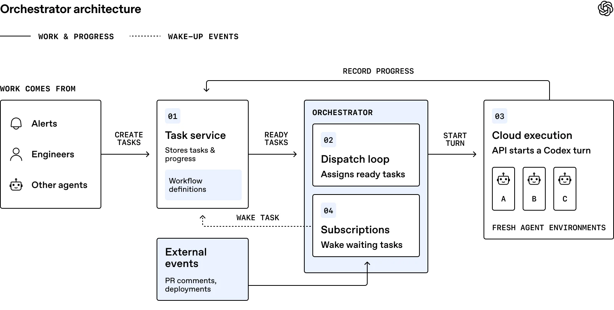

  FIELD NOTES ON AUTONOMOUS SYSTEMS

<h1 align="center">Autonomy Engineering</h1>

  <strong>How autonomous systems are built — and what keeps them working.</strong> 
  Real-world architectures, reusable patterns, and practical reconstructions.

  
  
  

  <a href="#start-here">Start here</a> &nbsp;·&nbsp;
  <a href="#explore-the-repository">Explore</a> &nbsp;·&nbsp;
  <a href="#how-we-study-a-system">Our approach</a> &nbsp;·&nbsp;
  <a href="CONTRIBUTING.md">Contribute</a>

---

## Beyond the agent loop

An autonomous system has to do more than produce a convincing answer. It needs to know what to work on, remember what happened, recover when execution breaks, and recognize when a person needs to decide.

This repository studies that engineering: the state, coordination, evidence, and operational decisions that make autonomous work possible.

> **The question behind every study:** What makes this system keep working after the first successful demo?

## Start here

### 01 / OpenAI Performance Factory

Our first case study examines [OpenAI's engineering article](https://openai.com/index/how-openai-performance-factory-keeps-chatgpt-fast/). Start with the source material, inspect the architecture, then explore a proposed local reconstruction.

[**Read the case study →**](case-studies/openai-performance-factory/README.md)

Original figure: OpenAI. <a href="case-studies/openai-performance-factory/source/README.md">Source and capture notes</a>

| Follow the evidence | Think through the implementation |
| :--- | :--- |
| [**Source summary**](case-studies/openai-performance-factory/source/summary.md) — a concise, attributed introduction | [**Reconstruction**](case-studies/openai-performance-factory/reconstruction.md) — a proposed coordinator and its invariants |
| [**Visual gallery**](case-studies/openai-performance-factory/diagrams/README.md) — three original figures and two browser captures | [**Tradeoffs**](case-studies/openai-performance-factory/tradeoffs.md) — choices, failure risks, and ways to assess them |
| [**References**](case-studies/openai-performance-factory/references.md) — publication and asset provenance | [**Architecture questions**](case-studies/openai-performance-factory/architecture.md) — details a reconstruction must resolve |

**Available now:** one case study, five captured visuals, and a reconstruction proposal. A runnable implementation is still to come. The full article stays linked at its source; local text is a summary.

## Explore the repository

| Area | The question it answers | Status |
| :--- | :--- | :--- |
| [**Case studies**](case-studies/README.md) | How does a particular system work? | First study available |
| [**Concepts**](concepts/README.md) | What ideas explain its behavior? | Topics outlined |
| [**Patterns**](patterns/README.md) | Which approaches can we reuse? | Topics outlined |
| [**Implementations**](implementations/README.md) | Can we build and test the mechanism? | Design proposal available |
| [**Resources**](resources/README.md) | Where can we inspect the evidence? | Primary source indexed |

## How we study a system

**01 · Observe.** Start with a primary source. Preserve useful visuals, record their origin, and make the evidence easy to inspect.

**02 · Explain.** Identify the components and decisions. Keep published facts, interpretations, and unanswered questions distinct.

**03 · Reconstruct.** Propose the smallest implementation that makes a mechanism understandable. State assumptions and define what must remain true.

**04 · Challenge.** Follow the failure paths: duplicate inputs, lost workers, stale results, missing events, and uncertain outcomes. Use experiments to test the design.

## Help build the field guide

Bring a primary source, a sharper explanation, a corrected assumption, or a small experiment that reveals how a system behaves. The [contribution guide](CONTRIBUTING.md) covers structure, evidence, and source capture.

---

  <strong>Read deeply. Build carefully. Make the mechanisms visible.</strong> 
  Original contributions: <a href="LICENSE">MIT</a>

