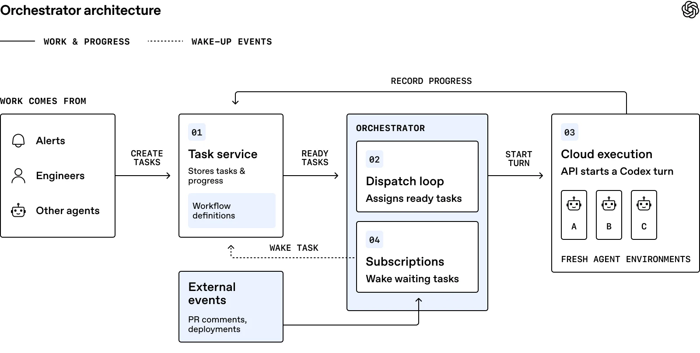

# OpenAI Performance Factory

A study of the system described in [OpenAI's article](https://openai.com/index/how-openai-performance-factory-keeps-chatgpt-fast/), by Okay Zed and Cyrus Forbes, published November 19, 2026.

**Status:** source review and visual capture completed; reconstruction is a design proposal, with no runnable implementation yet.

## Reading path

1. [Source summary](source/summary.md) — a short account of the published system.
2. [Source record](source/README.md) — what was captured and what is linked externally.
3. [Diagram gallery](diagrams/README.md) — three original figures and two browser captures.
4. [Architecture](architecture.md) — the published visual and unresolved questions.
5. [Reconstruction](reconstruction.md) — a possible teaching implementation.
6. [Tradeoffs](tradeoffs.md) — decisions to test in that implementation.
7. [References](references.md) — primary source and asset provenance.

Figure: OpenAI. See the [source record](source/README.md) and [third-party notice](../../THIRD_PARTY_NOTICES.md).

The original visuals are preserved locally. The full article remains available at the publisher's link; the local summary is not a transcription. Proposed schemas, concurrency controls, and failure handling in this study are our own design choices.
