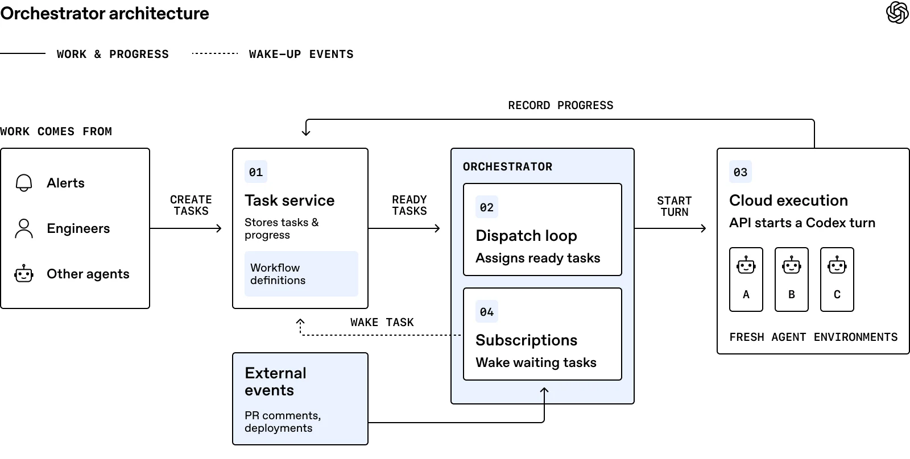

# Architecture

## Published view

Original figure from [OpenAI's article](https://openai.com/index/how-openai-performance-factory-keeps-chatgpt-fast/#the-performance-factory-systems-four-parts). This file is a captured publisher asset, not a redraw. See the [manifest](source/manifest.json) for its exact URL and digest.

The [source summary](source/summary.md) describes the published system. The [gallery](diagrams/README.md) preserves the remaining visuals.

## Questions a reconstruction must answer

The following are design questions, not documented implementation facts:

| Question | Why it matters in a new implementation |
| --- | --- |
| What transaction owns a task update? | Concurrent writers need a defined conflict rule. |
| How is worker ownership represented? | A timed-out worker may still be running. |
| What identifies a duplicate input? | Repeated delivery can create duplicate work. |
| What happens if an event arrives before a wait is registered? | A missed wake-up can leave a task stuck. |
| How are external side effects reconciled after a crash? | Retrying an ambiguous result can repeat an action. |
| Which version of a workflow governs existing tasks? | Deploying new definitions must not silently reinterpret old state. |
| How are budgets and deadlines enforced? | A loop needs explicit stopping conditions. |

This study does not establish the production database, queue, transaction isolation, lease protocol, event delivery guarantees, or recovery timings. The [reconstruction proposal](reconstruction.md) chooses explicit answers for an educational system; these should not be read as reverse-engineered OpenAI internals.
