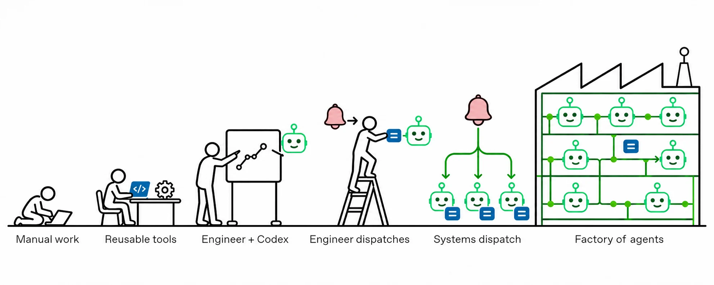
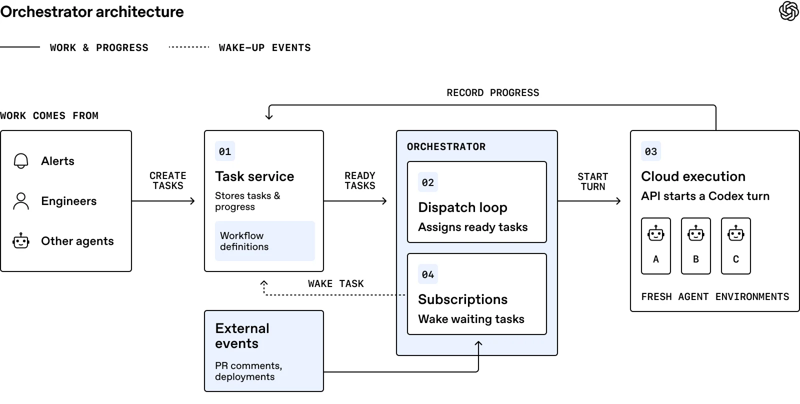
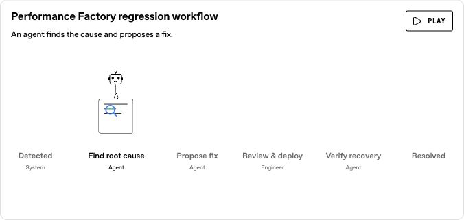
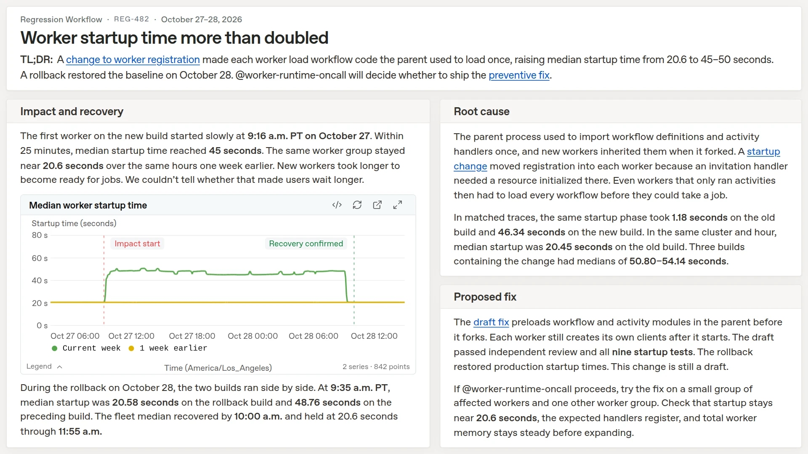
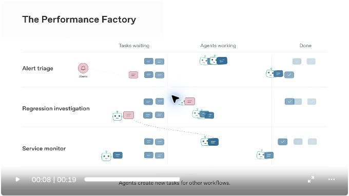

# Source visuals

These are captured OpenAI visuals from the [primary article](https://openai.com/index/how-openai-performance-factory-keeps-chatgpt-fast/), not generated illustrations. See [provenance](../source/manifest.json) and [capture notes](../source/README.md).

## Evolution — publisher image

## Architecture — publisher image

## Workflow — browser screenshot

This preserves one paused state of the interactive diagram. Open the [source section](https://openai.com/index/how-openai-performance-factory-keeps-chatgpt-fast/#the-first-workflow-from-alert-to-recovery) to view its animation.

## Example report — publisher image

## Multiple workflows — browser screenshot

Captured around 00:08 of the 00:19 embedded video. The screenshot includes the player controls; it does not preserve motion. View the [original player](https://player.vimeo.com/video/1246485623?h=0445ddf6d0) for the full sequence.
